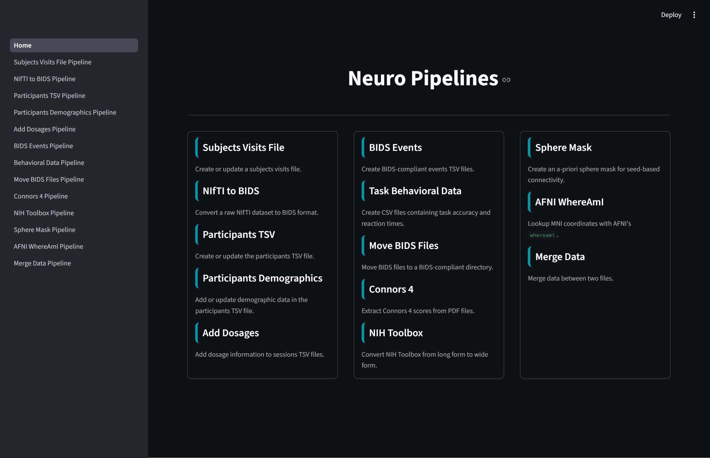
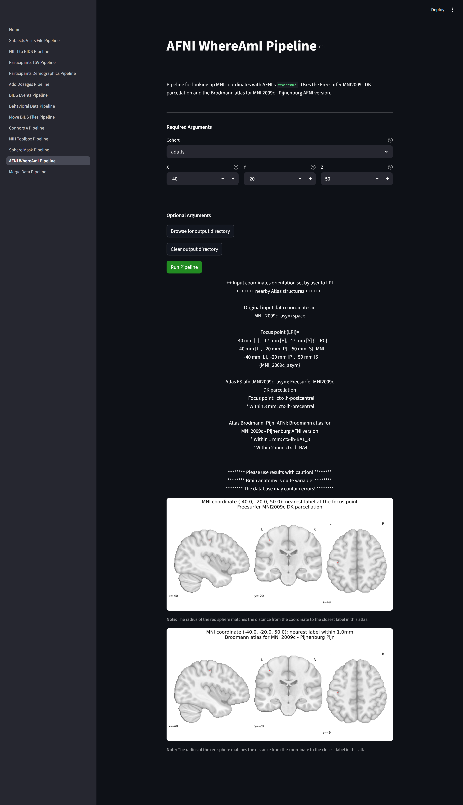

# Neuro Pipelines

Neuroimaging pipelines tailored for specific tasks and scan protocols in a multi-session, pharmacological fMRI study.

## Available Tools

- BIDS conversion
- Event (timing) file creation and task accuracy/reaction time calculations
- Preprocessing
- First and second level analyses (GLM and gPPI) with autogenerated HTML files for reporting
- Miscellaneous utilities
- Extracting Conners 4 data
- Organizing NIH toolbox data
- Look up brain regions for MNI coordinates (also available as a [web app](https://whereami-brain-lookup.duckdns.org) that accepts Talairach coordinates too)

## Web App (No Installation)

Look up brain regions for a coordinate in the browser: https://whereami-brain-lookup.duckdns.org

- Accepts MNI or Talairach coordinates (Talairach coordinates are converted to MNI with the Lancaster or Brett method)
- Returns the text output from AFNI's `whereami` and figures for the Freesurfer MNI2009c DK parcellation and the Brodmann atlas for MNI 2009c - Pijnenburg AFNI version

## No Installation (Windows Only)
This option doesn't require an explicit download of Python 3.10+ or any prior installation since the Python interpreter and other packages are bundled in the executable, so just:

- [Download NeuroPipelines Executable Build](https://github.com/donishadsmith/NeuroPipelines/releases/latest/download/NeuroPipelines-windows.zip)
- Extract contents from the Zip and double click on "NeuroPipelines.exe"
- If Windows Defender complains about an unrecognized app then click "More Info" then click "Run anyway"

*Notes*:
- First launch of pages may be slow as the cache for imports isn't built until the first launch of a page; other apps may be slow at first runtime since the import tax is paid at runtime.
- First launch will be even slower if your laptop has Microsoft Defender Antimalware Service activated, which it will if it's issued by an institution.

## Installation

**Requires Python 3.10+**

[Get Python 3.13 on Windows Store](https://apps.microsoft.com/detail/9PNRBTZXMB4Z?hl=en-us&gl=US&ocid=pdpshare)

[Get Python 3.13 on Python.org](https://www.python.org/downloads/release/python-31313/)

Clone the repository:

```bash
git clone https://github.com/donishadsmith/NeuroPipelines
cd NeuroPipelines
```

### Local Workstation

Install packages directly:

```bash
pip install -r requirements.txt
```

Or use a virtual environment:

```bash
python -m venv venv

# Linux
source venv/bin/activate

# Windows
venv\Scripts\activate

pip install -r requirements.txt
```

#### Run Streamlit App Hub
Double click on:
- "launch_app.bat" for Windows
- "launch_app.sh" for Linux
- "launch_app.command" for MacOS

or

In terminal:
```bash
streamlit run app.py
```




### HPC (Conda)

```bash
conda create -n neuropiplines python=3.10
conda activate neuropiplines
# or use:
# source activate neuropiplines
pip install -r requirements.txt
```
